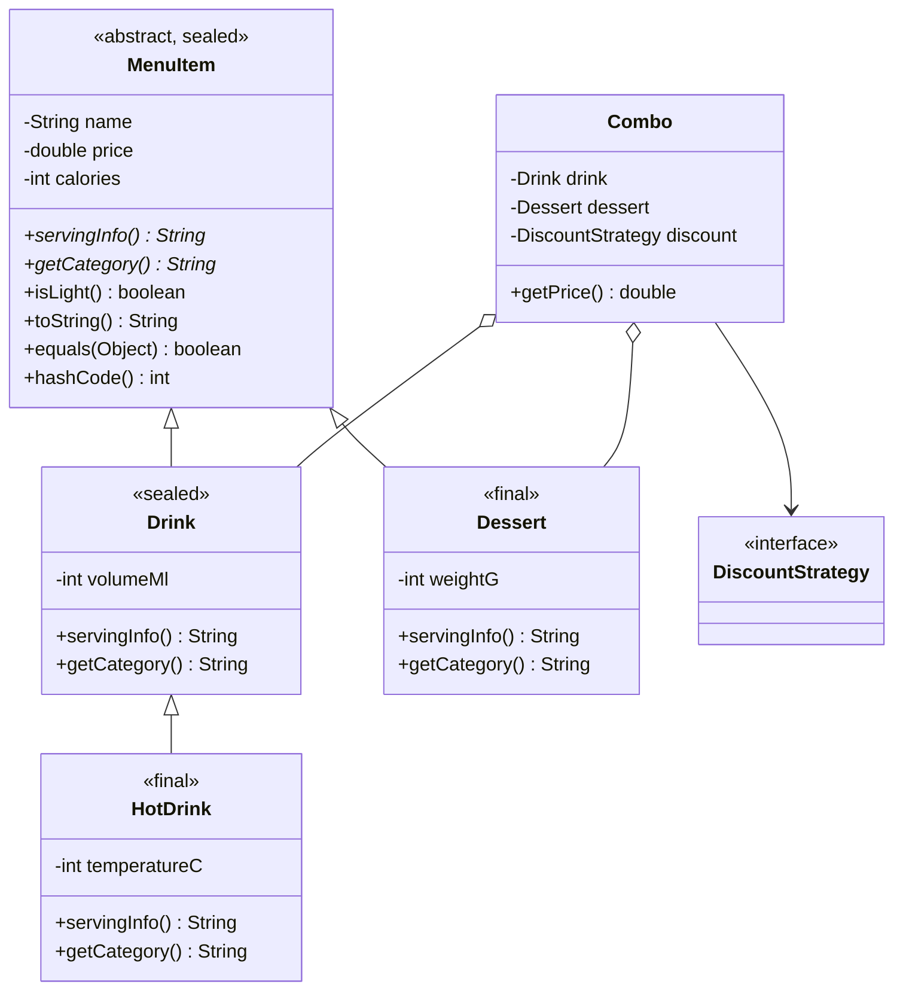

# Cafe Menu — «Ранкова Хвиля»

Консольний Java-застосунок для керування меню кафетерію: введення позицій, сортування, пошук, гнучка система знижок (відсоток, фіксована сума, промокоди зовнішнього сервісу) та сповіщення про зміни.

Проєкт розвивається лабораторними роботами: кожна — окрема гілка та Pull Request у `main`, а цей README доповнюється після кожної роботи.

## Зміст

* [Лабораторні роботи](#лабораторні-роботи)
* [Структура проєкту](#структура-проєкту)
* [Запуск](#запуск)
* [ЛР10: Maven та JDBC](#лр10-maven-та-jdbc)
* [Робота з Git](#робота-з-git)

## Лабораторні роботи

| №   | Тема                                               | Гілка                     | Статус     |
|-----|----------------------------------------------------|---------------------------|------------|
| ЛР1 | Облік замовлень кав'ярні                           | `lr1/cafe-order-console`  | виконано   |
| ЛР2 | Опрацювання масивів із застосуванням циклів        | `lr2/menu-arrays`         | виконано   |
| ЛР3 | Обробка винятків та власні підкласи Exception      | `lr3/menu-exceptions`     | виконано   |
| ЛР4 | Інтерфейси, абстрактні класи, паттерн Strategy     | `lr4/menu-discounts`      | виконано   |
| ЛР5 | Рефакторинг: Factory Method, Observer, Adapter     | `lr5/menu-patterns`       | виконано   |
| ЛР6 | Ієрархія класів, наслідування, sealed              | `лр6-реалізація-ієрархії-класів-на-основі-принципів-наслідування` | виконано   |
| ЛР7–9 | Типізований CRUD-сервіс: generics, колекції, сортування | `lr7-9/crud-service` | виконано   |
| ЛР10 | Maven та реляційна БД через JDBC                    | `lr10/maven-jdbc` | виконано   |

---

### ЛР1. Облік замовлень

Консольний застосунок для приймання та обліку двох замовлень за зміну.

**Що робить програма:**

* приймає дані про 2 замовлення (клієнт, напій, об'єм, ціна за порцію, кількість порцій, знижка);
* розраховує вартість кожного замовлення з урахуванням знижки та бонусу;
* показує чеки;
* підраховує виручку, середній чек, найбільший чек;
* перевіряє виконання планової виручки.

**Правила:**

* розмір напою: `400 мл і більше` — L, `300–399 мл` — M, `менше 300 мл` — S;
* якщо порцій `3 або більше`, до знижки додається `+5%`;
* загальна знижка не може перевищувати `100%`;
* план виконано, якщо `виручка >= план`.

---

### ЛР2. Меню кафетерію — масиви та цикли

Консольний застосунок для роботи з масивом об'єктів `MenuItem`, який користувач заповнює з клавіатури.

**Клас `MenuItem`:**

| Поле       | Тип      | Опис               |
|------------|----------|--------------------|
| `name`     | `String` | назва страви/напою |
| `category` | `String` | категорія          |
| `price`    | `double` | ціна, грн          |
| `calories` | `int`    | калорійність, ккал |

У класі є конструктор і перевизначений `toString()`.

**Що зроблено:**

* **Рівень 1:** масив заповнюється циклом `for` через `Scanner`, виводиться циклом `for-each`, підраховуються позиції дешевші за задану межу;
* **Рівень 2:** сортування за ціною методом бульбашки (власна реалізація, без `Arrays.sort()` і `Comparable`), масив виводиться до і після сортування;
* **Рівень 3:** метод `linearSearch(MenuItem[] menu, MenuItem sample)` шукає в масиві елемент, що збігається з об'єктом-зразком за всіма полями; повертає індекс або `-1`.

**Приклад:**

```text
Кількість позицій меню: 3
--- Позиція 1 ---
Назва: Кава
Категорія: Напій
Ціна: 50
Калорійність: 5
--- Позиція 2 ---
Назва: Чай
Категорія: Напій
Ціна: 30.5
Калорійність: 2
--- Позиція 3 ---
Назва: Торт
Категорія: Десерт
Ціна: 90
Калорійність: 400
=== Меню ===
Кава | Напій | 50.0 грн | 5 ккал
Чай | Напій | 30.5 грн | 2 ккал
Торт | Десерт | 90.0 грн | 400 ккал
Цінова межа: 40
Позицій дешевших за 40.0 грн: 1
=== До сортування ===
Кава | Напій | 50.0 грн | 5 ккал
Чай | Напій | 30.5 грн | 2 ккал
Торт | Десерт | 90.0 грн | 400 ккал
=== Після сортування за ціною ===
Чай | Напій | 30.5 грн | 2 ккал
Кава | Напій | 50.0 грн | 5 ккал
Торт | Десерт | 90.0 грн | 400 ккал
=== Пошук позиції ===
Назва: Торт
Категорія: Десерт
Ціна: 90
Калорійність: 400
Знайдено на позиції 3: Торт | Десерт | 90.0 грн | 400 ккал
```

---

### ЛР3. Обробка винятків

Розширення програми меню: усе з ЛР2 збережено, додано валідацію даних і обробку помилок.

**Власні винятки (ієрархія):**

| Клас                      | Батьківський клас | Додаткове поле    | Коли кидається         |
|---------------------------|-------------------|-------------------|------------------------|
| `MenuException`           | `Exception`       | —                 | базовий виняток домену |
| `InvalidPriceException`   | `MenuException`   | `double value`    | ціна `<= 0`            |
| `InvalidCaloriesException`| `MenuException`   | `int value`       | калорійність `< 0`     |

Винятки кидаються в конструкторі `MenuItem` через `throw new ...`.

**Що зроблено:**

* **Рівень 1:** `try-catch` для конкретних винятків:
  * `NumberFormatException` — некоректне число при введенні;
  * `NegativeArraySizeException` — від'ємна кількість позицій;
  * `ArithmeticException` — ділення на нуль при середній калорійності порожнього меню;
  * `ArrayIndexOutOfBoundsException` — перегляд позиції за неіснуючим номером.

  У кожному `catch` виводиться зрозуміле повідомлення. Блок `finally` у `main` гарантовано закриває `Scanner` і виводить повідомлення про завершення;
* **Рівень 2:** власний checked-виняток `InvalidPriceException` з конструктором `super(message)` і полем `value`, який перехоплюється окремим `catch`;
* **Рівень 3:**
  * кілька `catch` в одному `try` у правильному порядку: `NumberFormatException` → `InvalidPriceException` → `MenuException`;
  * повторне збудження: метод `readItemWithLog` логує помилку ціни і кидає її далі (`throw e;`) на вищий рівень;
  * `catch` базового класу `MenuException` перехоплює обидва підтипи (метод `demoHierarchy`).

**Приклад помилок при введенні:**

```text
Кількість позицій меню: abc
Помилка: кількість має бути цілим числом.
Кількість позицій меню: -1
Помилка: кількість не може бути від'ємною.
...
Ціна: -5
Калорійність: 10
[ЛОГ] Некоректна ціна: -5.0
Помилка: Ціна має бути більшою за 0 (введено: -5.0). Спробуйте ще раз.
...
Позиції з номером 9 немає в меню.
=== Демонстрація ієрархії винятків ===
Базовий catch: InvalidPriceException — Ціна має бути більшою за 0
Базовий catch: InvalidCaloriesException — Калорійність не може бути від'ємною
Роботу завершено.
```

---

### ЛР4. Інтерфейси та паттерн Strategy

Розширення програми меню: усе з ЛР2 і ЛР3 збережено, додано різні способи розрахунку знижки.

**Структура:**

| Тип                  | Вид                | Опис                                                              |
|----------------------|--------------------|-------------------------------------------------------------------|
| `DiscountStrategy`   | інтерфейс          | `calculate(price)`, default-методи `getName()` і `calculateTotal()` |
| `Describable`        | інтерфейс          | `describe()` — текстовий опис знижки                              |
| `NoDiscount`         | клас               | реалізує лише інтерфейс: ціна без змін                            |
| `BaseDiscount`       | абстрактний клас   | реалізує обидва інтерфейси, містить спільну логіку `notNegative()` та `describe()` |
| `PercentDiscount`    | клас               | знижка у відсотках, наслідує `BaseDiscount`                       |
| `FixedDiscount`      | клас               | фіксована знижка в гривнях, наслідує `BaseDiscount`               |
| `PriceCalculator`    | контекст Strategy  | делегує розрахунок поточній стратегії                             |

**Що зроблено:**

* **Рівень 1:** інтерфейс `DiscountStrategy` і три реалізації; масив `DiscountStrategy[]` і виклик `calculate()` у циклі показують різну поведінку (поліморфізм);
* **Рівень 2:**
  * default-методи `getName()` і `calculateTotal()` успадковують усі класи, `getName()` перевизначено в кожній знижці;
  * спільна логіка (ціна не стає від'ємною, опис) винесена в абстрактний клас `BaseDiscount`; `NoDiscount` не потребує спільної логіки, тому реалізує «чистий» інтерфейс;
  * `BaseDiscount` реалізує два інтерфейси одночасно: `DiscountStrategy` і `Describable`;
* **Рівень 3:** паттерн Strategy — `PriceCalculator` приймає стратегію через конструктор і метод `setStrategy()`, тому користувач змінює знижку під час роботи програми.

**Приклад:**

```text
=== Знижки (поліморфізм) ===
Без знижки: 100 грн -> 100.0 грн, 3 порції -> 300.0 грн
Знижка 10.0%: 100 грн -> 90.0 грн, 3 порції -> 270.0 грн
Знижка 5.0 грн: 100 грн -> 95.0 грн, 3 порції -> 285.0 грн
=== Ціни: Без знижки ===
Чай: 10.0 грн
A: 20.0 грн
1 - Без знижки
2 - Знижка 10.0%
3 - Знижка 5.0 грн
Оберіть знижку (0 - вихід): 2
=== Ціни: Знижка 10.0% ===
Чай: 9.0 грн
A: 18.0 грн
```

---

### ЛР5. Рефакторинг із паттернами GoF

Це рефакторинг наявного коду ЛР1–4, а не новий проєкт: знижки з ЛР4 тепер створює фабрика, зміну знижки відстежують спостерігачі, а старий зовнішній сервіс підключено через адаптер.

#### Рівень 1. Factory Method

**Проблема до рефакторингу:** у `Main` об'єкти знижок створювалися напряму через `new NoDiscount()`, `new PercentDiscount(10)`, `new FixedDiscount(5)` (і ще раз `new FixedDiscount(5)` в іншому місці). Клієнтський код знав усі конкретні класи, тому кожен новий тип знижки вимагав правок там, де створюються об'єкти.

**Рішення:** клас `DiscountFactory` з методом `create(String type, double value)`. Він приймає тип (`none`, `percent`, `fixed`, `promo`) і повертає готовий `DiscountStrategy`; невідомий тип дає `IllegalArgumentException`. У `Main` більше немає `new` для знижок.

**Результат:** щоб додати новий тип знижки, достатньо додати клас і один `case` у фабриці. Клієнтський код не змінюється.

#### Рівень 2. Observer

**Ситуація:** зміна знижки в `PriceCalculator` має бути помітна іншим частинам програми (журнал, статистика), але сам калькулятор не повинен про них знати.

**Рішення:**
* `DiscountListener` — інтерфейс спостерігача з методом `onDiscountChanged(oldName, newName)`;
* `PriceCalculator` — суб'єкт: зберігає список підписників (`addListener`) і сповіщає їх у `setStrategy`, якщо знижка справді змінилась;
* два спостерігачі на одному суб'єкті: `DiscountLogger` (друкує `[ЛОГ]`) і `DiscountCounter` (рахує зміни, підсумок показується в кінці).

#### Рівень 3. Adapter

**Ситуація:** є «зовнішній» клас `LegacyPromoService` з іншим API: метод `promoCost(long kopecks, String promoCode)` працює в копійках і не реалізує `DiscountStrategy`. Наш код очікує `calculate(double price)` у гривнях.

**Рішення:** `LegacyPromoAdapter implements DiscountStrategy` тримає `LegacyPromoService`, переводить гривні в копійки, викликає `promoCost()` і повертає результат у гривнях. Сам `LegacyPromoService` не змінюється.

**Чому саме Adapter, а не переписування класу:** `LegacyPromoService` імітує стороннє або застаріле API, яке не можна чи не варто змінювати: інший код може від нього залежати, а після оновлення бібліотеки правки зникнуть. Адаптер ізолює переклад викликів в одному місці й дозволяє використовувати старий сервіс як звичайну знижку разом з іншими стратегіями та `PriceCalculator`.

**Приклад:**

```text
=== Знижки (поліморфізм) ===
Без знижки: 100 грн -> 100.0 грн, 3 порції -> 300.0 грн
Знижка 10.0%: 100 грн -> 90.0 грн, 3 порції -> 270.0 грн
  Знижка 10.0%: 100 грн -> 90.0 грн
Знижка 5.0 грн: 100 грн -> 95.0 грн, 3 порції -> 285.0 грн
  Знижка 5.0 грн: 100 грн -> 95.0 грн
Промокод MORNING: 100 грн -> 85.0 грн, 3 порції -> 255.0 грн
...
Оберіть знижку (0 - вихід): 4
[ЛОГ] Знижку змінено: Знижка 10.0% -> Промокод MORNING
=== Ціни: Промокод MORNING ===
Чай: 8.5 грн
...
Змін знижки за сеанс: 2
```

### ЛР6. Ієрархія класів на основі наслідування

Це рефакторинг наявного коду ЛР1–5, а не новий проєкт. **Проблема до рефакторингу:** тип позиції меню визначало рядкове поле `category` (`"Напій"`, `"Десерт"`) — компілятор не відрізняв напій від десерта, помилка в написанні рядка не помічалась, а специфічні дані (об'єм, вага, температура) нікуди було покласти. Тепер тип позиції — це клас.

#### Діаграма класів



#### Рівень 1. Базова ієрархія

* **Перевірка «є» / «має»:** «напій є різновидом позиції меню» ✔, «десерт є різновидом позиції меню» ✔, «гарячий напій є різновидом напою» ✔.
* У `MenuItem` винесено спільні поля `name`, `price`, `calories`, конструктор (з валідацією з ЛР3) і методи. У підкласах — лише специфічні поля: `volumeMl`, `temperatureC`, `weightG`.
* Усі поля `private` (раніше були `public`), доступ — через геттери. `protected`-полів немає, тож обґрунтування не потрібне.
* Конструктори підкласів викликають `super(...)`.
* Кожен підклас перевизначає `getCategory()` і `servingInfo()` з `@Override`; `toString()` у підкласах будується як `super.toString() + " | " + власні поля`.
* Поліморфізм: у `InheritanceDemo` масив `MenuItem[]` містить `Drink`, `HotDrink`, `Dessert`, а `servingInfo()` у циклі дає різний результат.

#### Рівень 2. Абстракція, глибина, `this(...)`, `final`, `instanceof`

* **Абстрактний клас і методи.** `MenuItem` абстрактний, бо «просто позиції меню» не існує — у кафетерії продається напій або десерт. `servingInfo()` абстрактний, бо базовий клас не знає, у чому вимірюється порція (мл чи г): змістовної реалізації за замовчуванням немає, тож кожен підклас зобов'язаний її дати. Те саме для `getCategory()`.
* **Три рівні:** `MenuItem → Drink → HotDrink`.
* **Ланцюжок конструкторів.** Конструктори виводять повідомлення (вмикається `MenuItem.setTraceConstructors(true)`, щоб не засмічувати звичайну роботу). Для `new HotDrink("Капучино", 60, 120)`:

  ```text
     [конструктор] MenuItem(Капучино)
     [конструктор] Drink(Капучино, 250 мл)
     [конструктор] HotDrink(Капучино, 80 °C)
  ```

  Порядок: `HotDrink(3 арг.)` → `this(...)` → `HotDrink(4 арг.)` → `this(...)` → `HotDrink(5 арг.)` → `super(...)` → `Drink` → `MenuItem`. Перший рядок будь-якого конструктора — це `this(...)` або `super(...)`, тому тіла виконуються від кореня ієрархії до листка: об'єкт базового класу має бути повністю створений раніше, ніж підклас почне користуватися його полями.
* **`this(...)`.** `Drink(name, price, calories)` делегує у `Drink(name, price, calories, DEFAULT_VOLUME_ML)`; `HotDrink` має ланцюжок із трьох конструкторів. Код ініціалізації та валідації існує в одному місці.
* **`final`.**
  * метод `MenuItem.isLight()` — `final`: «легка позиція» (< 100 ккал) — бізнес-правило кафетерію; якщо підклас зможе його змінити, фільтр «легких» позицій дасть різні результати для різних типів;
  * `HotDrink` і `Dessert` — `final` класи: спадкоємців не планується (і цього вимагає sealed, див. нижче).
* **`instanceof` + pattern matching:** `if (item instanceof Drink drink) { drink.getVolumeMl(); }`. Те саме застосовано в `Main` для `Describable` (замість приведення типів).
* **Статичний і динамічний тип.** Статичний (оголошений) тип змінної `MenuItem item` відомий компілятору й визначає, які методи *можна викликати*: `item.getVolumeMl()` не скомпілюється. Динамічний (фактичний) тип — клас об'єкта в пам'яті (`HotDrink`); він визначає, *яка реалізація* перевизначеного методу виконається (віртуальний виклик). Щоб дістатися до методу підкласу, потрібен `instanceof` або приведення типу.

#### Рівень 3. `equals`/`hashCode`, композиція, діаграма

* **`equals()` і `hashCode()`.** Реалізовані в `MenuItem`, а `Drink`, `HotDrink`, `Dessert` додають свої поля через `super.equals(o)`; `hashCode()` узгоджений з `equals()`. `linearSearch` тепер використовує `equals()` замість старого `sameAs()`. *(Починаючи з ЛР7–9 `equals`/`hashCode` визначено в `BaseEntity` за `id`, а порівняння за всіма полями перейменовано на `sameContent()`.)*
* **Симетрія: `instanceof` проти `getClass()`.** Демонстрація в `InheritanceDemo`:

  ```text
  Реалізація з getClass():  drink.equals(hot) = false, hot.equals(drink) = false  (симетрично)
  Реалізація з instanceof:  base.equals(sub) = true, sub.equals(base) = false  (симетрію порушено!)
  ```

  З `instanceof` базовий клас вважає підклас рівним собі (`o instanceof Base` істинне), а підклас, який перевіряє додаткове поле, базовий об'єкт відхиляє — `a.equals(b) != b.equals(a)`. Якщо ж підклас не порівнює нові поля, порушується транзитивність. **Вибір: `getClass()`** — підкласи додають стан, тож `Drink` і `HotDrink` з однаковою назвою, ціною й об'ємом — різні позиції меню. Ціна рішення — порушення принципу підстановки Лісков для `equals` (екземпляр підкласу не рівний екземпляру базового класу); для моделі домену це прийнятно.
* **Композиція замість наслідування: `Combo`.** Комбо «напій + десерт» можна було б спробувати зробити `Combo extends Drink` («бо там є напій»). Але *«комбо є різновидом напою» — хибне твердження*. Що зламалося б:
  * `Combo` успадкував би `volumeMl`, `servingInfo()` (порція в мл), `getCategory()` = «Напій» — для набору з напою й десерта це безглуздо;
  * десерт довелося б додавати окремим полем, а наслідувати можна лише один клас — `Combo extends Dessert` одночасно неможливо;
  * `switch` по sealed-ієрархії та `MenuItem[]` почали б сприймати комбо як напій;
  * у комбо інший спосіб формування ціни (знижка на суму), який довелося б «вмикати» всупереч успадкованій логіці.

  Тому `Combo` **містить** `Drink`, `Dessert` і `DiscountStrategy` (повторне використання знижок із ЛР4) і не входить в ієрархію `MenuItem`.
* **Діаграма класів** — вище (Mermaid).
* **Sealed + `switch` з pattern matching** (самостійне опрацювання). `MenuItem` оголошено як `abstract sealed ... permits Drink, Dessert`, `Drink` — `sealed ... permits HotDrink`, `HotDrink` і `Dessert` — `final`. У `MenuService.details()` ланцюжок `if (x instanceof ...)` замінено на `switch (item)` із патернами `case HotDrink`, `case Drink`, `case Dessert` (порядок важливий: специфічніший підклас раніше за базовий, інакше `HotDrink` ніколи не буде досягнуто). **Гарантія sealed:** компілятор знає повний, закритий перелік підкласів, тому `switch` по такому типу може бути *вичерпним* без `default`. Якщо прибрати `case Dessert` — компіляція падає з помилкою `the switch expression does not cover all possible input values`; якщо додати новий дозволений підклас — кожен такий `switch` у проєкті перестає компілюватися, доки його не оновлять. Тобто забутий випадок перетворюється з помилки часу виконання на помилку компіляції. Усі дозволені підкласи мусять лежати в одному пакеті (`model`), бо проєкт не є іменованим модулем.

**Що змінилося в застосунку:** при введенні позиції запитується тип (1 — напій, 2 — гарячий напій, 3 — десерт) і відповідні специфічні поля; поле `category` зникло, натомість категорію повертає `getCategory()`. Після демонстрації винятків виводиться блок «ЛР6: ієрархія класів» (`InheritanceDemo`).

**Приклад (скорочено):**

```text
=== ЛР6: ієрархія класів ===
--- Ланцюжок конструкторів: new HotDrink("Капучино", 60, 120) ---
   [конструктор] MenuItem(Капучино)
   [конструктор] Drink(Капучино, 250 мл)
   [конструктор] HotDrink(Капучино, 80 °C)
--- Поліморфізм: масив MenuItem[] ---
Лимонад | Напій | 40.0 грн | 90 ккал | 300 мл  → порція: 300 мл, легка: true
Американо | Гарячий напій | 45.0 грн | 5 ккал | 250 мл | 85 °C  → порція: 250 мл, 85 °C, легка: true
Чізкейк | Десерт | 85.0 грн | 380 ккал | 150 г  → порція: 150 г, легка: false
--- Композиція: Combo має напій і десерт ---
Комбо: Американо + Чізкейк (Знижка 10.0%) = 117.0 грн, 385 ккал
--- switch + pattern matching по sealed-ієрархії ---
Американо: гарячий напій, 250 мл, 85 °C
```

### ЛР7–9. Типізований CRUD-сервіс: узагальнення, колекції, сортування

Сутності — позиції меню (`Drink`/`HotDrink`, `Dessert`). `MenuItem` тепер наслідує `BaseEntity` (поля `long id` — незмінне, `String name`), тож один і той самий `InMemoryCrudService<T>` працює і з напоями, і з десертами без жодних змін. Демонстрація — `CrudDemo` (запускається з `Main` після блоку ЛР6 або окремо: `java -cp out com.morningwave.cafe.CrudDemo`).

| Тип | Призначення |
|-----|-------------|
| `BaseEntity` | абстрактна база: `id`, `name`, `equals`/`hashCode` за `id`, компаратор `BY_NAME` |
| `EntityNotFoundException` | виняток із полем `id` |
| `CRUDService<T extends BaseEntity>` | `findById`, `save`, `delete`, `findAll`, `findAllSorted(Comparator<? super T>)`, default `findAllSortedByName()` |
| `InMemoryCrudService<T>` | універсальне сховище на `LinkedHashMap<Long, T>` |
| `MenuItemService` / `InMemoryMenuItemService` | `findAllSortedByNameAndByPrice()`; клас успадковує `InMemoryCrudService<MenuItem>` |
| `EntityUtils.printAll(Collection<? extends BaseEntity>)` | утиліта виведення |

Семантика: `save` — додає або замінює запис із тим самим `id` (кількість записів не росте); `delete` повертає `true`/`false`; `findById` кидає `EntityNotFoundException`. Методи сортування повертають нову колекцію, сховище не змінюють.

#### Рівень 1

* **Чому `EntityNotFoundException` — перевірений (`extends MenuException` → `Exception`).** Відсутність запису за id — очікувана ситуація предметної області (користувач ввів неіснуючий номер), яку викликач може й повинен обробити: показати повідомлення, запропонувати інший id. Перевірений виняток змушує це зробити на рівні компілятора і узгоджений з ієрархією з ЛР3. Мінус — `throws` у сигнатурі й незручність у лямбдах; для помилок програмування (null, неправильний аргумент) ми використовуємо неперевірені винятки.
* **Навіщо `T extends BaseEntity`.** Без обмеження `T` для компілятора — лише `Object`. Тоді всередині сервісу не можна було б викликати `entity.getId()` (ключ у `Map` для `save`) і `getName()` (сортування за назвою в `findAllSortedByName`); довелося б приймати «ключ» окремим аргументом або робити небезпечні приведення типів. Обмеження також не дозволяє створити сервіс для випадкового типу (`InMemoryCrudService<String>` не скомпілюється).

#### Рівень 2

* **Comparator, а не Comparable.** `Comparable` задає один «природний» порядок, вшитий у клас. Для меню немає очевидного природного порядку: за назвою, ціною чи калорійністю — залежить від екрана. `Comparator` дає змогу мати довільну кількість порядків без зміни сутності (`BY_NAME`, «назва → ціна», за ціною), комбінувати їх через `thenComparing` і передавати ззовні в `findAllSorted`. Недолік `Comparable` для нашої задачі: другий порядок (за ціною) довелося б робити все одно через `Comparator`, а `compareTo` за назвою змішував би порядок із самою сутністю та суперечив би `equals` (див. нижче). Назви порівнюються без урахування регістру (`String.CASE_INSENSITIVE_ORDER`).
* **Чому `findAllSortedByNameAndByPrice()` не в `CRUDService`.** Не кожна сутність має ціну чи й «друге поле»; загальний інтерфейс не повинен знати про поле `price`. Тому метод винесено в `MenuItemService extends CRUDService<MenuItem>`, а реалізує його `InMemoryMenuItemService extends InMemoryCrudService<MenuItem>`. Метод `findAllSortedByName()` залежить лише від `BaseEntity.getName()`, тож він загальний.
* **Вибір колекції для сховища.** Операції сервісу — пошук/заміна/видалення за `id` та періодичне сортування. Обрано `LinkedHashMap<Long, T>`: усе за `id` за O(1), порядок додавання стабільний (відсортований список — окрема копія). *n* — кількість записів.

  | Колекція | `findById` | `save` (нова/оновлення) | `delete` | відсортований список | Висновок |
  |----------|-----------|--------------------------|----------|----------------------|----------|
  | `ArrayList<T>` | O(n) лінійний пошук | O(1) додавання; оновлення O(n) (треба знайти) | O(n) пошук + зсув елементів | копія + сортування O(n log n) | простий, але повільний пошук за id |
  | `HashMap<Long, T>` | O(1) | O(1) | O(1) | O(n log n); порядок обходу не визначений | швидко, але порядок «до сортування» довільний |
  | `LinkedHashMap<Long, T>` | O(1) | O(1); оновлення порядок не змінює | O(1) | копія значень + `sort` O(n log n) | **обрано**: швидко + передбачуваний порядок виводу |
  | `TreeMap<Long, T>` | O(log n) | O(log n) | O(log n) | сортування за `id` готове, за назвою — усе одно O(n log n) | дерево впорядковує за ключем (id), а не за назвою — користі для наших сортувань немає |

  `TreeSet` за назвою для сховища не підходить: коректність залежить від компаратора, який вважає записи з однаковою назвою **однаковими**, і другий «Чай» просто зник би.
* **`equals`/`hashCode` у `BaseEntity` — за `id`** (`final`, `getClass()` для симетрії). Раніше `equals` порівнював усі поля (ЛР6); ця логіка збережена як `MenuItem.sameContent()` і далі використовується для пошуку за зразком (`linearSearch`). **Узгодженість із `compareTo`/компаратором:** компаратор за назвою **не узгоджений** з `equals`: два різні записи «Чай» (різні `id`) мають `compare == 0`, але `equals == false`. Наслідки: для списків і сортування це нормально (стабільне сортування просто залишає порядок), але в `TreeSet`/`TreeMap` із таким компаратором дублікати за назвою були б втрачені — тому ми не використовуємо їх як сховище. Компаратор «назва → ціна» також не повністю узгоджений: два записи з однаковою назвою й ціною, але різним `id`, теж дадуть `0`.

#### Рівень 3

* **`Comparator<? super T>`, а не `Comparator<T>`.** Узагальнення інваріантні, тож `Comparator<BaseEntity>` не є `Comparator<Drink>`. Але компаратор, що вміє порівнювати будь-яку `BaseEntity`, вміє порівнювати й `Drink` (принцип PECS: *consumer super* — компаратор **споживає** елементи). `? super T` дозволяє передати в сервіс напоїв один спільний `BaseEntity.BY_NAME` або `Comparator<MenuItem>` за ціною; з `Comparator<T>` потрібен був би окремий компаратор для кожного типу (див. `demoWildcards`).
* **Обидва методи сортування реалізовані через `findAllSorted`**, а `findAllSortedByName()` — `default`-метод інтерфейсу (ЛР4): жодна реалізація не повторює код.
* **`printAll(Collection<? extends BaseEntity>)`.** `List<Drink>` **не** можна передати як `List<BaseEntity>`, бо інакше через посилання `List<BaseEntity>` можна було б додати `Dessert` у список напоїв, зруйнувавши типобезпеку. `? extends BaseEntity` («продюсер») гарантує, що ми лише **читаємо** елементи як `BaseEntity` і нічого не додаємо — тому метод приймає `List<Drink>`, `List<MenuItem>`, `Set<Dessert>` тощо.

**Приклад виводу (скорочено):**

```text
--- CRUD: InMemoryCrudService<Drink> ---
Після додавання двох: 2 запис(и)
Оновлення id=1 (ціна 50): записів 2, ціна тепер 50.0
delete(2) = true
delete(2) ще раз = false
findById(99): Сутність з id=99 не знайдена [id=99]
--- Сортування: MenuItemService ---
findAllSortedByNameAndByPrice() (два «Чай» різняться ціною):
  #4 Американо | Напій | 40.0 грн | 5 ккал | 200 мл
  #3 Чай | Гарячий напій | 30.0 грн | 2 ккал | 250 мл | 80 °C
  #1 Чай | Напій | 45.0 грн | 2 ккал | 250 мл
  #2 Чізкейк | Десерт | 85.0 грн | 380 ккал | 150 г
Після сортування сховище не змінилося: (#1, #2, #3, #4 — порядок додавання)
```

Конструктори сутностей тепер приймають `id` першим параметром (`new Drink(1, "Чай", 45, 2, 250)`).

## ЛР10: Maven та JDBC

Проєкт використовує Maven (Java 21, UTF-8), H2 у файловому режимі та пул з'єднань HikariCP. JDBC-сервіси реалізують той самий `CRUDService<T>`/`MenuItemService`, що й in-memory версія; SQL і перетворення рядків (`mapRow`) зосереджені у `AbstractJdbcCrudService<T>`, а `JdbcMenuItemService` і `JdbcMenuItemNoteService` задають SQL та мапінг типів.

Схема створюється з `src/main/resources/init.sql` автоматично під час кожного запуску. Скрипт ідемпотентний. Зв'язок: `menu_items (1) ──< menu_item_notes (N)`. Зовнішній ключ використовує `ON DELETE CASCADE`: нотатка не має самостійного сенсу без позиції меню, тому видалення позиції очищує її нотатки.

#### Запуск з нуля

Потрібні JDK 21+ та Maven 3.8+. З кореня проєкту виконайте:

```shell
mvn compile
mvn exec:java
```

Файл БД створюється автоматично у `data/cafeteria.mv.db`. Налаштування за замовчуванням — у `src/main/resources/application.properties`; для іншої БД відредагуйте `db.url`, `db.username` і `db.password`, а також додайте JDBC-драйвер у `pom.xml`. Параметри можна перевизначити системними властивостями `app.db.url`, `app.db.username` і `app.db.password`. Для JDBC-демонстрації виконайте `mvn exec:java -Dexec.args="--jdbc-demo"`.

#### JDBC-демонстрації

* `save` додає або оновлює за `id`; `findAllSortedByNameAndByPrice` і `findAllSortedByName` використовують `ORDER BY`, а `findPage(page, pageSize)` — `LIMIT/OFFSET`.
* `saveWithNote` записує позицію та нотатку в одній транзакції. Деморежим навмисно повторно вставляє зайвий первинний ключ нотатки: виняток спричиняє `rollback`, який також скасовує вставлення позиції.
* SQL-ін'єкція: небезпечний варіант `"... WHERE name = '" + name + "'"` з вводом `' OR '1'='1` перетворює умову на `name = '' OR '1'='1'`. У робочому `findByName` застосовано `WHERE name = ?` і `PreparedStatement.setString`; той самий ввід є лише буквальним ім'ям, не SQL-кодом. Небезпечний варіант наведено лише тут, у README.
* `JdbcDemo` вимірює вставлення 500 записів по одному та через `addBatch/executeBatch` і виводить обидва часи в мілісекундах. Один локальний запуск (Windows, JDK 25, H2): 694 мс по одному проти 116 мс пакетно. Результати залежать від диска, ОС, JVM та навантаження; запускайте демо локально для актуального виміру.

#### Пул з'єднань замість одного спільного Connection

Singleton тут зберігає `HikariDataSource`, а не єдине `Connection`: кожна операція отримує власне з'єднання з пулу й повертає його через try-with-resources. Один глобальний `Connection` був би небезпечним при паралельних запитах (перемішування операцій), при розриві з'єднання (потрібне відновлення) та під час одночасних транзакцій (спільний стан auto-commit/commit/rollback). Пул обмежує кількість фізичних з'єднань і видає окреме логічне з'єднання кожному виклику.

## Структура проєкту

Код лежить у `src/main/java`, ресурси БД — у `src/main/resources` (стандартна структура Maven-проєкту), один публічний клас у файлі. Нові лабораторні додаються як нові класи й пакети поруч.

```text
.
├── pom.xml
├── README.md
├── .gitignore
└── src
    └── main
        ├── java/com/morningwave/cafe
        │   ├── Main.java                         точка входу, автоматична ініціалізація БД
        │   ├── JdbcDemo.java                     транзакція, PreparedStatement, batch і пагінація
        │   ├── CrudDemo.java                     демонстрація in-memory CRUD (ЛР7–9)
        │   ├── db
        │   │   ├── DBConnection.java             Singleton з HikariCP
        │   │   └── DataAccessException.java
        │   ├── model
        │   │   ├── BaseEntity.java
        │   │   ├── MenuItem.java
        │   │   ├── MenuItemNote.java             друга сутність, FK до menu_items
        │   │   └── ...                           інші моделі меню
        │   ├── exception
        │   │   └── ...                           винятки предметної області
        │   ├── service
        │   │   ├── CRUDService.java
        │   │   ├── InMemoryCrudService.java
        │   │   ├── AbstractJdbcCrudService.java  Template Method, спільний CRUD
        │   │   ├── JdbcMenuItemService.java
        │   │   └── JdbcMenuItemNoteService.java
        │   ├── ui
        │   ├── discount
        │   ├── factory
        │   ├── observer
        │   ├── legacy
        │   └── adapter
        └── resources
            ├── application.properties            JDBC URL та облікові дані
            └── init.sql                          ідемпотентна схема БД
```

| Пакет       | Лабораторна | Призначення                                        |
|-------------|-------------|----------------------------------------------------|
| `model`     | ЛР2, ЛР6, ЛР10 | дані предметної області та сутності БД           |
| `exception` | ЛР3, ЛР7–10 | власні винятки                                     |
| `service`   | ЛР2, ЛР7–10 | in-memory та JDBC CRUD-сервіси                    |
| `db`        | ЛР10        | Singleton-пул JDBC-з'єднань                       |
| `ui`        | ЛР2–ЛР3     | введення даних                                     |
| `discount`  | ЛР4         | інтерфейси, абстрактний клас, Strategy             |
| `factory`   | ЛР5         | створення знижок                                   |
| `observer`  | ЛР5         | інтерфейс спостерігача та спостерігачі             |
| `legacy`    | ЛР5         | несумісний зовнішній клас                          |
| `adapter`   | ЛР5         | адаптер до `DiscountStrategy`                      |

## Запуск

Потрібні Java 21+ та Maven 3.8+. Команди виконуйте з кореня проєкту: `mvn compile` для компіляції та `mvn exec:java` для запуску. Параметри JDBC та запуск демонстрації описані в [розділі ЛР10](#лр10-maven-та-jdbc). Дробові числа меню вводьте через крапку, наприклад `45.5`.

## Робота з Git

Одна лабораторна — одна гілка і один PR у `main`.

```bash
git checkout -b lrN/short-name
git add .
git commit -m "LRN: короткий опис"
git push -u origin lrN/short-name
```

Після кожної лабораторної в README додається новий рядок у таблицю та новий розділ `### ЛРN`.
